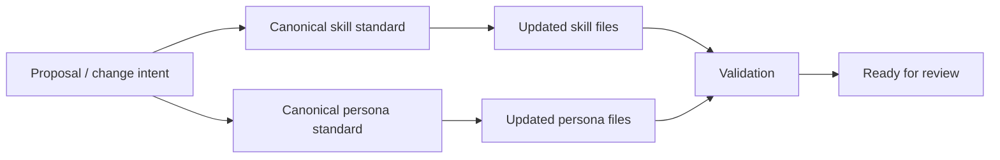

# Design: Ensure Agent Skills Follow Standards

## Summary

This change standardizes the repository’s shared agent assets so the skill and persona definitions follow a single, maintainable structure and align with the repo’s Software Fabric stage flow. The design keeps the scope intentionally narrow: it governs repository guidance for agent files rather than adding new application behavior or broader evaluation tooling.

## Technology Choices

| Concern | Choice | Rationale |
|---|---|---|
| Standards source | Repository-local conventions and SDLC flow | The repo already defines the persona roster, domain ownership, and stage handoff model in `openspec/config.yaml`, so the standard should align with existing project structure instead of inventing a new pattern. |
| Scope boundary | Skill and persona documentation only | The issue is about governance clarity and consistency for shared agent assets, not runtime features or product logic. |
| Update pattern | Minimal targeted edits to representative files | The repo already contains strong examples; the goal is to normalize the standard without broad churn or unrelated refactoring. |

## Component Diagram

## Data Model

No runtime data model is introduced. The design affects documentation structure and repository conventions only.

## API Contracts

None. This change does not introduce service interfaces, network contracts, or application APIs.

## ADRs

### ADR-001: Keep the standard repository-local and documentation-first
- **Context:** The repository already defines a stage-based agent model and expected persona roster in `openspec/config.yaml`. Several skill and persona files are already strong examples, so the gap is consistency and explicit governance rather than missing runtime architecture.
- **Options:**
  - Add a large measurement framework and broad evaluation scripts.
  - Keep the change confined to definition structure and consistency.
- **Decision:** Keep the change narrow, repo-local, and standards-focused.
- **Consequences:** The change remains low-risk and easy to review, but it will not produce broad quantitative benchmarking artifacts unless a separate change adds them.

## Non-Functional Requirements
- Performance: Not applicable; this is a documentation-only change.
- Security: No new product or runtime surface area; review remains focused on repository asset consistency.
- Backward Compatibility: The update preserves the repo’s existing stage model and agent ownership, while tightening language and layout expectations.
- Validation Method: Use a lightweight baseline-vs-improvement check during T08/T09 by scoring a small representative sample of skill/persona files against a shared rubric: purpose clarity, required sections, execution guidance, handoff clarity, and scope guardrails. Record before/after results in the validation notes without adding broad benchmark tooling or persistent evaluation infrastructure.
