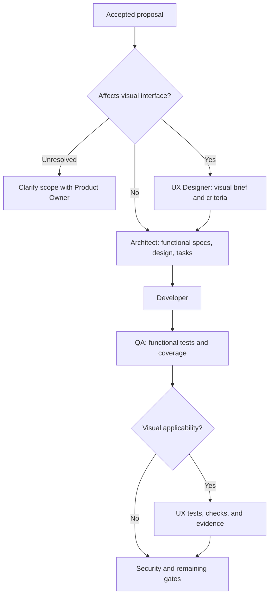

# Design

## Context

See [proposal.md](./proposal.md) for accepted scope and exclusions.
The relevant personas already reference UX, but their skills and canonical
specs disagree. The orchestrator currently requires a brief for all design
handoffs and runs only Python and .NET test commands.

The shared sync tool distributes skills and workflows, but does not distribute
`.github/scripts/` as an asset group. Any new helper referenced by a consumer
workflow must therefore travel with a supported shared asset. Existing
unittest discovery covers `.github/scripts/test_*.py`; the focused persona
contracts live in `tests/test_ux_designer_stage.py`.

The two earlier UX changes remain active. Their overlapping deltas describe an
unconditional brief and must be reconciled before syncing this change.

## Goals / Non-Goals

**Goals:**

- One explicit applicability contract shared by planning, personas, and gates.
- A nonvisual route with no UX-only artifacts, tooling, or test configuration.
- Visual criterion traceability and enforceable automation evidence.
- Preserve existing functional, security, legal, and release obligations.

**Non-Goals:**

- Inferring visual scope from filenames or adding a UI framework.
- Replacing consumer test infrastructure or building a generic command runner.
- Certifying manual accessibility or real-device checks automatically.
- Archiving changes or introducing new synchronization asset groups.

## Decisions

### ADR-1: Store applicability in the existing proposal

Use one `## UX Applicability` section with one fenced JSON object:

```json
{
  "required": false,
  "reason": "API-only change; no visual interface behavior is affected."
}
```

`required` must be a JSON boolean and `reason` a nonempty scope explanation.
True means affected visual behavior, not merely a repository containing UI
code. Mixed changes set true but limit UX work to their visual surfaces.
Missing sections, duplicate sections or keys, invalid types, and ambiguous
declarations fail with an actionable diagnostic.

The Product Owner owns this scope decision; proposal acceptance covers it.
Architecture and QA must flag conflicts with the accepted scope rather than
trusting an inaccurate declaration. Scope changes require renewed acceptance.
The gate validates the declaration, not the truth of arbitrary prose.

Alternatives rejected: a separate exemption artifact burdens nonvisual
changes; inferring applicability from a missing brief silently bypasses UX;
classifying an entire repository misclassifies mixed products.

### ADR-2: Keep the routes conditional everywhere



Update Product Owner, UX Designer, Architect, Developer, and QA personas and
the idea-to-spec, UX design, spec-to-design, test-generation, and kickoff
skills. Align applicable OpenSpec planning entry points, shared instructions,
and README guidance, without changing their approval boundaries.

Remove mandatory nonvisual briefs and their CLI-specific UX checklists.
CLI output and API contracts remain ordinary functional requirements and
tests; no special UX artifact is required.

Architecture consumes the visual brief only when required and carries its
criterion IDs into the design, delta scenarios, and testing tasks. QA reads
functional specs on both routes and reads UX criteria only on the visual
route. The existing functional test-level decisions and coverage floor remain.

Alternative rejected: retaining unconditional skill inputs would let skill
invocation restore the old requirement despite corrected persona guidance.

### ADR-3: Share a small gate helper through the QA skill

Add a standard-library Python helper under
`.github/skills/test-generation/scripts/validate_ux_gate.py`. This location
ships with the existing skills asset group. Add unittest fixture coverage in
`.github/scripts/test_validate_ux_gate.py` using the repository's existing
file-based import patterns.

The helper accepts an explicit change directory and phase. It validates
applicability on both routes, checks the visual brief for design and testing
entry, and checks visual evidence at test completion or security entry.
Nonvisual decisions return a clear UX-not-applicable result without reading
or creating UX artifacts.

Workflow change discovery must use the PR base/head diff, exclude archived
changes, preserve actual changed paths, and check each active change
independently. Resolve paths within the intended change root; invalid or
escaping paths and read failures must fail explicitly.

Update the orchestrator's UX, design, test, and security-entry paths to use
this helper. A mistakenly applied UX label on nonvisual work explains the
direct design route without demanding UX work. Re-evaluate the relevant
active gates on PR head updates, not just label events. Preserve the existing
label-conflict policy and normal functional test execution.

Alternative rejected: duplicating inline parsing in several jobs makes
nonvisual exemptions and failure behavior drift.

### ADR-4: Separate UX evidence completeness from actual automation

For visual work only, QA writes `ux-validation.json` in the change directory.
The report contains a `criteria` list. Each entry identifies:

- `id`: a stable ID from a brief heading such as `### UX-01: Outcome`.
- `method`: `automated` or `manual`.
- `result`: `passed`, `failed`, or `blocked`.
- `evidence`: a nonempty test-result or documented-check reference.

The helper rejects empty or malformed reports, duplicate IDs, missing brief
criteria, unknown IDs, failed or blocked results, and missing evidence.
Dimension exclusions belong in the accepted brief with reasons, not as fake
passing checks. QA records actual device versus emulated coverage in the
referenced evidence.

Use consumer-owned CI workflows to execute existing browser, accessibility,
or other UX suites. A trusted repository variable, `UX_CHECK_NAMES`, supplies
a nonempty JSON list of the expected GitHub check-run names for visual work.
The orchestrator reads check runs for the evaluated PR head SHA, requires
unambiguous successful results, and rejects absent, pending, skipped,
cancelled, or failed required checks. Do not select itself as a required UX
check. Allow bounded waiting for configured consumer checks, with a clear
timeout failure instead of indefinite polling.

No commands from a proposal, brief, or evidence report are executed. No new
browser stack is installed by the shared gate. Consumers retain responsibility
for configuring and running their appropriate UX suites in CI.
No UX configuration, report, or check-run lookup is required for nonvisual
changes.

The report gate checks mapping and evidence completeness. Actual automated
success comes from current-head CI results, not the report's claimed status.
Manual evidence still requires QA and reviewer judgment; a nonempty URL alone
does not prove accessibility or device conformance.

Alternatives rejected: coverage percentages do not test UX; trusting a
report's pass flag is not automation evidence; a universal browser runner
would impose unrelated dependencies on consumers.

### ADR-5: Reconcile specs without archiving unrelated work

Use this change's three deltas as the conditional UX contract. Reconcile
overlapping UX requirements in `add-ux-designer-persona` and
`strengthen-ux-designer-brief-workflow` so future syncs preserve that contract.
Record the supersession in their planning context, retaining unrelated
requirements and historical task completion. Any future apply of revised
planning still needs current acceptance.

After implementation approval, invoke `openspec-sync-specs` for the relevant
UX deltas and this change, verifying the resulting canonical requirements.
Update directly related persona counts, inputs, lifecycle overviews,
collaboration text, and diagrams that a requirement merge alone would leave
stale. Do not synchronize unrelated active changes or archive anything.

Alternative rejected: syncing the original deltas unchanged would reintroduce
mandatory UX for CLI/API changes; changing only overview prose would leave
contradictory normative requirements.

## Verification

- Extend the existing persona contract tests to cover conditional inputs in
  personas, skills, instructions, specs, and workflow invocation.
- Add gate fixtures for CLI-only, API-only, visual, mixed, and multi-change
  PRs; missing or duplicate decisions; absent briefs; malformed reports;
  criterion mismatches; missing evidence; failed or stale configured checks;
  and explicit file-read failures.
- Execute the helper's real CLI against temporary change directories to prove
  nonvisual routes succeed without UX files or runner configuration, and that
  missing visual requirements fail with actionable output.
- Test workflow integration rather than only testing the helper in isolation.
- Run the focused pytest file and helper unittest file first, then directly
  affected existing workflow/skill contract suites.
- Lint changed Markdown and run strict OpenSpec validation for this change and
  the two reconciled UX changes. Validate resulting canonical specs, identifying
  any unrelated baseline issues rather than silently fixing them.
- Record a lightweight before/after clarity, execution-guidance, checklist,
  and handoff comparison using the existing assessment format. Contract tests
  are not proof of actual consumer UX performance.

## Risks / Trade-offs

- Inaccurate scope declarations can bypass UX: Product Owner acceptance and
  downstream review must check the rationale against actual scope.
- Existing consumers lack the applicability section: document migration and
  fail clearly instead of guessing or forcing a nonvisual brief.
- Consumers may protect their orchestrator from sync: document coordinated
  adoption of the skill helper and workflow changes.
- CI checks may finish after a label event: bound waiting and report pending
  checks; rerunning the gate must re-read current results.
- Automation cannot verify every manual claim: preserve explicit evidence
  review and never claim full conformance from structural validation.

## Migration Plan

1. Implement guidance and the helper with focused tests after plan approval.
2. Update the orchestrator and ship it with the QA skill helper.
3. Add applicability to proposals before their next relevant handoff.
   Nonvisual proposals need only the existing proposal section, not UX files.
4. Configure named UX CI checks and record validation only for visual changes.
5. Reconcile and sync the relevant specs; validate both routes and all affected
   contracts before reporting implementation complete.
6. For rollback, revert only this change's implementation through review;
   preserve existing consumer work and do not delete prior UX artifacts.
