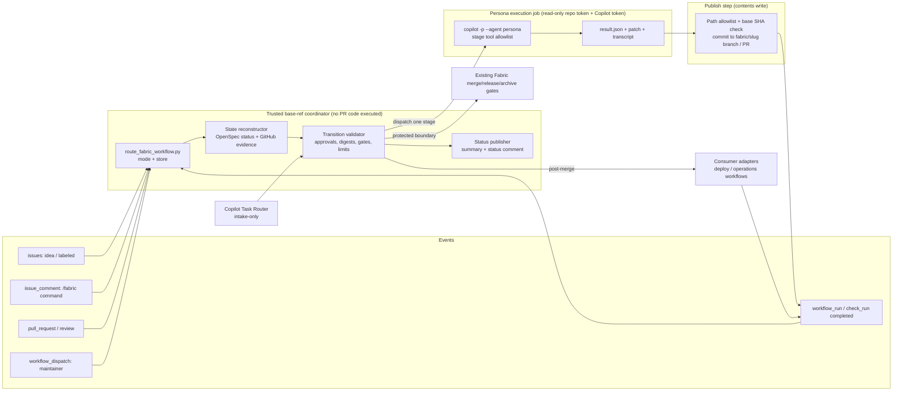

# Design: End-to-End Software Fabric Orchestration

## Summary

A deterministic **Fabric coordinator** runs from trusted default-branch workflow
code. It reconstructs a change's lifecycle state from authoritative sources:
OpenSpec artifacts, content digests, reviews, authorization commands, check
evidence, and prior dispatch records. It then validates the next allowed
transition and dispatches at most one bounded **persona execution job**. That
job runs the existing `.github/agents/*.agent.md` persona through the
programmatic Copilot CLI (`copilot -p … --agent <persona>`) with a stage-scoped
tool allowlist and no repository write credential. It returns a structured
result and a patch artifact.

A separate publish step verifies the patch against the stage's path allowlist.
It also checks that the base revision is still current before committing. The
coordinator never treats agent text, labels, or task checkboxes as approval.
It publishes route, stage, status, execution reference, and next action to an
Actions summary and one coordinator-owned status comment.

Merge, release, and archive still use the existing protected Fabric gate
controls. Deployment and operations use consumer-configured adapters, and a
missing adapter blocks the lifecycle. GitHub Agentic Workflows (`gh aw`) is the
documented fallback if the pre-implementation feasibility gate fails.

## Context

See [proposal.md](proposal.md) for motivation. The current state is as follows:

- [sdlc-orchestrator.yml](../../../.github/workflows/sdlc-orchestrator.yml) has
  label-triggered jobs that validate structure and post handoff comments. No job
  dispatches a persona or advances a stage. Unlabeled PRs are skipped silently.
- [copilot-task-router.yml](../../../.github/workflows/copilot-task-router.yml)
  assigns `copilot` and asks it to "implement this issue end-to-end" from a
  label or `/copilot` in the issue body. This path bypasses intake, proposal
  acceptance, and implementation authorization.
- The merge, release, and archive controls (`fabric-*-gate.yml`) and the
  `fabric-verify-change` scripts (`fabric_gate.py`, `fabric_control_policy.py`,
  `gate-policy.json`, `run_fabric_gate_control.py`) already enforce trusted,
  revision-bound evidence. They are disabled by default through
  `FABRIC_PROTECTED_OPERATIONS_ENABLED`, and their gate App IDs are `0`.
- `route_fabric_workflow.py` already resolves sticky Fabric versus standalone
  routing. OpenSpec 1.16.0 provides `status --json`, `instructions`, and
  `validate --strict`.
- Copilot CLI 1.0.106 was verified locally. It provides `-p`, `--agent`,
  `--allow-tool`, `--share`, and `--log-dir`. The npm registry lists
  `@github/copilot` 1.0.107 as the current version. `github/gh-aw` v1.0.1 is
  active and not archived.
- `ralphke/agentic-shared` is a personal repository. Copilot CLI in Actions
  therefore needs `COPILOT_GITHUB_TOKEN`, a fine-grained PAT with Copilot
  Requests permission. Organization `GITHUB_TOKEN` billing is unavailable.

## Goals / Non-Goals

**Goals:**

- Execute real persona work for each applicable stage through a single supported
  mechanism. Make every dispatch observable and every advancement verifiable.
- Make state reconstruction idempotent so that duplicate, concurrent, stale, or
  replayed events cannot repeat work or advance an outdated revision.
- Keep the trusted coordinator separate from untrusted PR content and agent
  output. Keep agent credentials separate from gate-App credentials.
- Default to disabled. The disabled and unconfigured states must be visible and
  must never succeed silently.

**Non-Goals:**

- Hosting a database, service, or UI. State lives in GitHub and the repository.
- Running untrusted fork PRs through the agent. Forks are always blocked and
  reported.
- Implementing every runtime. The comparison selects one; the other is fallback.
- Changing upstream `openspec-*` skills or the OpenSpec CLI.
- Enabling protected operations, creating credentials, or configuring branch
  protection.

## Technology Choices

| Concern | Choice | Rationale |
| --- | --- | --- |
| Coordinator | Python 3.14 standard library module under `.github/skills/fabric-propose/scripts/` invoked by Actions | Matches existing Fabric scripts and tests; deterministic and unit-testable without network |
| Agent runtime | Copilot CLI (`@github/copilot`, pinned exact version after feasibility gate) | Supports existing `.agent.md` personas through `--agent`, non-interactive prompts, tool allowlists, and transcripts |
| Fallback runtime | GitHub Agentic Workflows (`gh aw`) | GitHub-recommended framework with a safe-outputs model; selected only if CLI feasibility fails |
| Planning state | OpenSpec CLI 1.16.0 `status`/`validate --json` | Upstream source of artifact readiness. It does not establish approval |
| Durable state | Reconstructed per event from GitHub (dispatch runs, check runs, reviews, authorized commands) and repository artifacts. A coordinator comment is only a display cache | No mutable trusted store to corrupt. Replays converge |
| Approval evidence | PR reviews and `/fabric` commands from users with write or higher permission, bound to a planning-content digest and head SHA | Bound to the reviewed content. Labels and agent text are excluded |
| Gate evidence | Existing `fabric_gate.py` and `gate-policy.json` | Reuses trusted revision-bound controls. Nothing new to trust |
| Consumer config | `.github/fabric/orchestration.yml`, a protected consumer-local path | Holds the enable flag, limits, and adapters. It contains no secrets |

## Component Diagram

## Data Model

There are no database or schema migrations. The following logical records are
used.

**Change identity:** `{repo, change_slug, mode, store, issue_number?,
pr_number?, branch: fabric/<slug>}`. Mode and store come from
`route_fabric_workflow.py` and are sticky. The first coordinator status comment
records them. A later event with a conflicting mode blocks.

**Stage ledger:** This is a reconstructed view, not stored state.

| Field | Source |
| --- | --- |
| `stage` | Ordered lifecycle: `intake → proposal → [ux] → design → plan-review → implement → test → security → [legal] → review → merge → deploy → operate → archive` |
| `status` | `pending, awaiting-approval, dispatched, running, succeeded, failed, blocked, cancelled, superseded` |
| `revision` | Head SHA and `planning_digest` (SHA-256 over normalized `proposal.md`, `design.md`, `tasks.md`, and `specs/**`) |
| `dispatch_key` | `sha256(change_slug, stage, revision, attempt)`, embedded in the execution run name and summary |
| `attempt` / `rework` | Counted from prior dispatch runs with the same change and stage |
| `execution_ref` | Actions run URL, transcript artifact, and resulting commit SHA |
| `blocker` | A machine code plus human next action, such as `APPROVAL_MISSING:implementation-authorization` |

**Approval record:** `{kind: proceed|proposal-acceptance|plan-acceptance|
implementation-authorization, actor, actor_permission, planning_digest,
head_sha, source_url, created_at}`. An approval is valid only if the actor has
write or higher permission, is a human issuing explicit approval rather than
an agent-generated claim, and the digest and
SHA match the current values. Any planning edit changes the digest and makes
earlier plan acceptance and implementation authorization stale.

The same authorized human may supply all planning approvals, including for
work they initiated. The maintainer's own Copilot credential may authenticate
execution; no separate automation account is required. Credential ownership
does not establish human approval. Agent outputs cannot issue approval commands
or reviews, and execution jobs have no repository write credential. This is
single-maintainer planning, not independent review: no comment can substitute
for a required GitHub review or trusted delivery gate.

**Agent result (`fabric-stage-result.json`, schema version 1):**
`{schema_version, change, stage, persona, base_sha, planning_digest, outcome:
completed|needs-clarification|blocked|failed, outputs:[paths], questions:[],
summary}`. This is advisory only. The coordinator verifies outputs
independently.

**Consumer config (`.github/fabric/orchestration.yml`):** `enabled: false`,
`runtime: copilot-cli`, `max_attempts: 2`, `max_rework: 3`,
`stage_timeout_minutes`, `daily_dispatch_limit`,
`adapters: {deploy: {workflow, environment}, operations: {workflow}}`, and
`stage_paths` overrides limited to narrowing defaults. Add
`authorized_delivery_actor_id` (the numeric GitHub user ID of `ralphke` in this
repository, explicitly configured by each consumer), and
`budget: {max_dispatches_per_change, max_execution_minutes_per_change,
estimated_charge_per_dispatch, currency, estimate_source}`. Budget limits are
positive values required before enabling execution. The estimate source records
the owner's current billing assumptions and verification date; no fabricated
price or free-usage assumption is supplied.

**Budget ledger:** Reconstruct dispatched attempts and their run durations for
the change, including failed, cancelled, and superseded attempts. Before each
dispatch reserve one attempt and its full configured timeout; concurrent
reservations count against both limits. Block if the reservation would exceed
either limit or if accounting is incomplete. Report the estimated remaining
charge as remaining dispatches multiplied by the configured per-dispatch
estimate, alongside its source. This is an estimate, not a monetary spending
cap: actual Copilot billing must be checked through the owner's billing controls.

## API Contracts

**Maintainer commands** are issue or PR comments. They are accepted only from
actors with write or higher permission and are parsed with an exact grammar:

| Command | Effect |
| --- | --- |
| `/fabric proceed` | Records intake Proceed. Starts the proposal stage |
| `/fabric accept proposal <digest12>` | Accepts the current proposal digest. Unlocks UX or design |
| `/fabric accept plan <digest12>` | Accepts the current complete proposal, specs, design, and tasks |
| `/fabric authorize implementation <digest12>` | Authorizes implementation. Requires a matching accepted plan digest |
| `/fabric retry <stage>` | Retries if the attempt limit has not been reached and the stage is failed or blocked |
| `/fabric cancel` | Cancels in-flight dispatches and marks the change `cancelled` |
| `/fabric status` | Republishes the reconstructed status |
| `/fabric adopt <full-head-sha>` | Acknowledges an external revision after review; revalidates outputs and approvals before resuming |

A digest mismatch or unknown command is rejected and the reason is published. No
state changes.

**Execution job inputs** come from the coordinator's `workflow_call` or
`workflow_dispatch`: `change_slug, stage, persona, base_sha, planning_digest,
dispatch_key`. **Outputs** are the `fabric-stage-result` artifact, the
`fabric-stage-patch` artifact (`git diff --binary` against `base_sha`), and the
`fabric-transcript` artifact from `--share`.

**Stage-to-persona and path allowlist** use these defaults:

| Stage | Persona agent | Allowed write paths |
| --- | --- | --- |
| proposal | product-owner | `openspec/changes/<slug>/proposal.md`, `.openspec.yaml` |
| ux | ux-designer | `openspec/changes/<slug>/ux-brief.md` |
| design | architect | `openspec/changes/<slug>/{design.md,tasks.md,specs/**}` |
| implement | developer | Repository paths except `.github/workflows/**`, `.github/fabric/**`, gate policy, and `openspec/specs/**` |
| test | qa-engineer | Test paths, plus task checkbox updates |
| security, legal, review | security-engineer, legal-compliance, code-reviewer | No repository writes. They publish findings only |
| deploy, operate | Consumer adapters | Defined by the adapter. Not written by the agent |

The coordinator publishes stage dispositions as a check run named
`Fabric orchestration / <stage>`. These checks are informational. They are not
listed in `gate-policy.json` as trusted gate evidence.

## Decisions (ADRs)

### ADR-1: Build/Buy/Vibe — adopt a runtime, build only a thin coordinator

**Decision:** Adopt GitHub's agent runtime and build only deterministic
transition, evidence, and publish logic. **Alternatives:** Building an agent
platform is out of scope. A third-party orchestrator SaaS would add a provider
and legal review without reusing the personas. **Consequence:** About 1,000
lines of tested Python and YAML.

### ADR-2: Copilot CLI as the baseline runtime; Agentic Workflows as fallback

| Criterion | Copilot CLI in Actions | GitHub Agentic Workflows |
| --- | --- | --- |
| Reuse `.github/agents/*.agent.md` | Yes. `--agent <name>` was verified in local help | Indirect. Personas would be re-expressed as workflow Markdown, which duplicates them |
| Deterministic coordinator control | Full. A normal job is called by the coordinator | Its own frontmatter triggers and compiled `.lock.yml`. The coordinator becomes split |
| Write isolation | Must be built: read-only token, patch artifact, and validated publish | Built in through safe-outputs |
| Personal-repo authentication | Fine-grained PAT `COPILOT_GITHUB_TOKEN` with Copilot Requests | PAT or API key also required |
| Completion signal | Job exit, result artifact, and `workflow_run` | Workflow run and safe-output events |
| Consumer sync footprint | One reusable workflow and script | Requires a `gh aw` compile step and lock-file drift management in consumers |

**Decision:** Use Copilot CLI because persona reuse and coordinator ownership
are the proposal's central requirements. Adopt the safe-outputs *pattern*
through patch artifacts and a validated publish step.

**Gate:** Before the coordinator is built, tasks 1.1 to 1.4 must demonstrate
the following in this repository:

- a capability matrix covering every existing persona, including the
  adapter-owned DevOps/SRE and Operations SRE handoffs
- bounded `--agent` runs for every CLI-dispatched persona, not just Product Owner
- non-interactive tool restriction
- a transcript artifact
- authentication using `COPILOT_GITHUB_TOKEN`
- a list of tools, MCP servers, runtime dependencies, and permissions required
  by each persona, with an exercised runner-compatible binding or explicit block

Do not assume VS Code's `.vscode/mcp.json` or tool names work in Actions.
Document supported CLI/file/patch equivalents without changing persona duties
or granting privileged writes. A missing required capability blocks that
persona and the feasibility gate; it is not silently omitted. If a capability
cannot be supported safely, stop and re-plan with `gh aw`.

### ADR-3: Reconstructed state instead of a stored state machine

The coordinator derives state for every event. Its sources are prior dispatch
runs (searched by `dispatch_key`), check runs, reviews, authorized commands,
and OpenSpec status. A per-change `concurrency` group without cancel-in-progress
serializes coordinators. Before dispatch, the coordinator re-queries for an
existing run with the same `dispatch_key`. **Alternatives:** A JSON state file
on a branch would require write races and become a trusted mutable store. An
issue-comment state blob could be edited. **Consequence:** More API calls per
event, but bounded per change. Replayed or out-of-order events converge to the
same decision.

VS Code Copilot Chat and manually assigned cloud agents remain usable. They do
not acquire coordinator authority. Any branch update not attributable to a
verified coordinator publish is an external revision, regardless of its commit
author string. It pauses new dispatches and supersedes in-flight results.
The publish job uses a compare-and-swap ref update against its expected SHA;
it never force-pushes, merges, or rebases over external work.
An authorized `/fabric adopt <full-head-sha>` acknowledges exactly the current
external head, revalidates artifacts and invalidates revision-bound evidence.
It does not accept a changed plan or authorize implementation. A racing update
leaves the change blocked for another review and adoption.

### ADR-4: Content-digest-bound approvals

Approvals bind to `planning_digest` and the head SHA, not to a label or time.
Labels remain descriptive. The coordinator sets `stage:*` labels to mirror
state. It applies `stage:proposal` to eligible unlabeled Fabric work and flags
conflicting labels for review, but never reads labels as approval.

### ADR-5: Credential separation and untrusted content

The coordinator and publish jobs run workflow code from the default branch
(`issue_comment`, `pull_request_target`, `workflow_run`, and `workflow_dispatch`)
and never check out or execute PR code. The execution job receives the
following:

- a `GITHUB_TOKEN` with `contents: read`
- `COPILOT_GITHUB_TOKEN`
- no gate-App, deploy, or protected-operation secrets

Fork PRs are blocked. Security, legal, and review personas cannot approve their
own or each other's work. Their outputs are findings. Dispositions still come
from the trusted gate sources and independent human reviews.

Single-maintainer planning permits the same human to own the Copilot credential
and issue the ordered acceptance commands. It is explicitly reported as reduced
assurance, not two-person review. Separate job permissions and credentials for
Copilot inference, repository publishing, and protected operations remain
mandatory; account separation is not. Existing GitHub self-review restrictions and all gate
policies remain unchanged; this plan does not solve independent delivery review
by relabeling a bot finding or human comment as approval.

### ADR-6: Task Router becomes an intake adapter

The `copilot-task` label and `/copilot` body text now route into Fabric intake.
They label `idea`/`stage:proposal` and publish what the user must do next. They
no longer assign Copilot or request end-to-end implementation. An explicit
`fabric-mode:standalone` label is routed through `route_fabric_workflow.py
--mode standalone`. The router reports that Fabric orchestration does not apply,
does not dispatch personas, and does not bypass repository controls.

### ADR-7: Post-merge delivery through consumer adapters

Deployment and operations call consumer-declared workflows through
`workflow_dispatch`. They record the returned run and environment deployment.
Completion requires the existing archive-lifecycle evidence: `deployment`,
`slo`, `alerts`, `runbook`, `stability`, and `postmortem` where applicable.
These must come from trusted sources and bind the merged SHA. A missing adapter
returns `BLOCKED:ADAPTER_MISSING`. The archive stage then runs
`fabric-verify-change` and the archive gate with fresh evidence. A complete
delta verification is required before sync or move.

### ADR-8: Shared prerequisites, separate execution contexts

Extract the common Node.js 26+ and OpenSpec 1.16.0 setup and verification into
one repository-owned composite action. Keep the cloud agent's required
`copilot-setup-steps` job as a wrapper and call the same action from CLI
execution. Pin the CLI separately; do not install it or expose its credential
in cloud setup merely for symmetry. The current cloud setup's `@latest`
OpenSpec installation is replaced by the supported pin when implemented.

Privileged jobs resolve the action from the trusted base SHA, never PR code.
Cloud setup has no gate or deployment credentials; shared setup must not
execute consumer scripts with privileged secrets. Verify both entry points
resolve identical prerequisites. This avoids copying steps or assuming that
the cloud-only setup workflow automatically runs in CLI jobs.

### ADR-9: Per-change usage reservation and transparent cost estimates

Use dispatch-count and execution-time budgets in addition to daily and retry
limits. Reserve the full timeout before dispatch and reconcile it with the
completed run duration. An interrupted or unaccounted run retains its reservation
until verified. A retry or adoption never resets accounting. Budget exhaustion
requires an explicit reviewed trusted-config increase, not `/fabric retry`.
Provider billing is not reliably bounded by wall time, so report estimates and
their assumptions separately from enforceable execution limits.

### ADR-10: Maintainer-only merge-triggered Fabric delivery

Only the configured `authorized_delivery_actor_id` may initiate merge-triggered
Fabric delivery, manually start Fabric orchestration, or rerun those workflows.
For this repository the configured human is `ralphke`; consumers explicitly
configure their own actor ID rather than inheriting this username.

Resolve the merged PR through authenticated GitHub API data and require
`merged: true`, the expected base branch, the exact merge revision, and
`merged_by.id` equal to the configured actor ID. Do not authorize from a commit
author, PR author, label, push actor, or the actor of a `workflow_run` alone.
Ambiguous PR mappings, bot/auto-merges, and another user's merge block delivery.
Manual starts check `github.actor_id`; reruns additionally verify the current
`github.triggering_actor` through GitHub API against the configured numeric ID,
not just the original actor.

Automated delivery continuations may run as Actions only when independently
verified workflow/run provenance traces to the authorized merge and exact
revision; they cannot introduce a new target or bypass gates. Apply the same
authorization preflight at every reusable workflow and adapter entry point,
before receiving privileged secrets or performing writes/deployment.
Ordinary pull-request CI remains automatic and is not restricted by this rule.

These are planned workflow controls, not a restriction on GitHub administrators
or all repository workflows. They do not prevent someone with sufficient access
from editing controls, merging directly, or invoking an independently authorized
deployment path. Branch/environment restrictions remain separate setup (#22);
no live settings are changed by this plan.

## Non-Functional Requirements

- **Security:** Use least-privilege job permissions and pin actions by SHA in
  new workflows. Apply the existing zizmor/actionlint backlog (#21) to new
  files. Prompts include untrusted text only inside delimited data blocks.
  Publish validation rejects symlinks, path traversal, binary changes outside
  the allowlist, and workflow or policy edits.
- **Cost bounds:** Use `max_attempts`, `max_rework`, `stage_timeout_minutes`,
  `daily_dispatch_limit`, and per-change dispatch/time reservations. Retry
  never bypasses an exhausted limit. Publish consumed/reserved usage, the
  next-run estimate, and the configured maximum dispatch-based estimate.
  Missing estimates or unverifiable accounting block new dispatches.
- **Reliability:** Reconstruction is idempotent. An interrupted execution
  produces no result artifact, so it is treated as `failed` with the attempt
  counted. Cancellation stops runs that share the dispatch key.
- **Observability:** Every eligible event writes an Actions summary row with
  route, stage, status, `execution_ref`, and next action. Ineligible events log
  the reason. No eligible event is skipped silently.
- **Backward compatibility:** When `enabled: false`, existing structural
  validation jobs keep running. The coordinator reports
  `BLOCKED:ORCHESTRATION_DISABLED` with setup guidance. Consumers opt in by
  adding the config and secret.
- **Legal and data:** Repository content is sent to Copilot under the
  repository owner's existing Copilot terms. No new provider is added.
  Regulated-data triggers still route to `stage:legal`.

## Risks / Trade-offs

- **[Risk]** CLI flags or behavior may change between versions. **Mitigation:**
  Pin an exact version and run a contract test on `--help` output during the
  feasibility gate and on upgrade.
- **[Risk]** Untrusted issue or PR content may contain prompt injection.
  **Mitigation:** The agent has no write credential. Path allowlists are
  enforced after execution. Human plan acceptance is required before
  implementation. Security and review stages run before merge.
- **[Risk]** A single maintainer cannot independently review their own PR.
  **Mitigation:** Report reduced assurance, isolate inference from repository
  write credentials, and preserve independent delivery gates. Reusing the
  maintainer's credential does not make agent findings independent review.
- **[Risk]** Copilot Chat or a cloud agent can update the automation branch.
  **Mitigation:** Pause, reject stale patches, and require explicit SHA-bound
  adoption without overwriting external work or carrying approvals forward.
- **[Risk]** A persona's editor-only tools may not exist on a runner.
  **Mitigation:** Gate implementation on all-persona capability evidence and
  both setup entry points; required missing bindings block execution.
- **[Risk]** Actual premium-request charges can differ from estimates.
  **Mitigation:** Require dated owner-supplied assumptions, enforce conservative
  dispatch/time reservations, and retain separate provider billing controls.
- **[Risk]** API-heavy reconstruction may hit rate limits. **Mitigation:** Use
  per-change concurrency and a bounded query window. Report rate limiting as
  `blocked` with retry guidance.
- **[Trade-off]** The coordinator stays split from the gate controls. Gates
  remain authoritative for merge, release, and archive, and the coordinator
  only routes to them.

## Migration Plan

1. Land the coordinator, execution workflow, config schema, and tests with
   `enabled: false`. This preserves current behavior and adds visible status.
2. Convert the Task Router to intake-only in the same release, and record the
   behavior change in the release notes.
3. Run the isolated demonstration in a sandbox repository or on a demo change
   with explicit authorization. Record the actual executions and the negative
   path.
4. Consumers opt in by adding `.github/fabric/orchestration.yml` and
   `COPILOT_GITHUB_TOKEN`, the authorized delivery actor ID, and reviewed
   per-change budget limits and billing assumptions.
5. **Rollback:** Set `enabled: false`, or revert the release tag. Persona and
   gate assets are unchanged, so manual Fabric operation still works.

## Resolved Design Question

When no PR exists for a change, the publish step commits to `fabric/<slug>`.
It then opens a **draft PR** labeled `stage:proposal` as the single review
surface. Drafts never satisfy merge gates.
