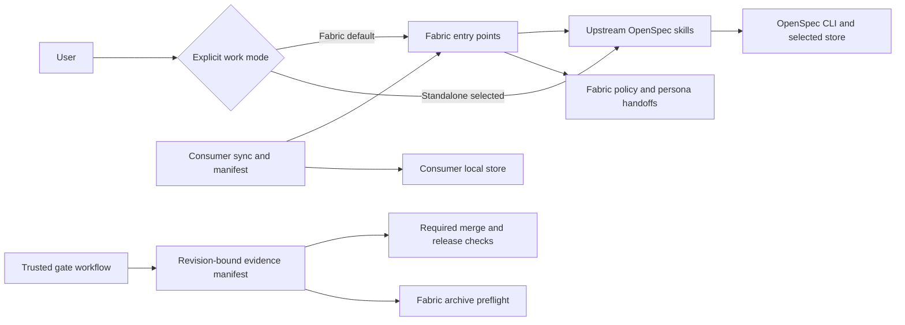

# Design: Separate Software Fabric from OpenSpec

## Context

See [proposal.md](./proposal.md) for motivation and scope. The shared repository
currently distributes customized `openspec-*` skills, applies Fabric
instructions broadly, and restores policy into regenerated skills. The
archive-readiness workflow validates local artifacts and optionally checks PR
evidence; it does not establish every Fabric gate. Consumer sync uses
three-way file comparison and protects configured paths.

The proposal was accepted for design in the current conversation. The user
selected three design constraints: preserve Fabric as the default for existing
consumers with an explicit standalone selection; use a new revision-bound
evidence manifest; and initially support exactly OpenSpec 1.16.0.

## Summary

Keep upstream-generated OpenSpec skills under upstream ownership and move
Fabric orchestration and policy to separately named entry points. Use an
explicit work-mode selection without weakening repository controls, and
evaluate Fabric gates using a trusted, revision-bound evidence manifest at
merge, release, and archive as applicable. Preserve local stores and consumer
extensions during an explicitly reviewed migration.

## Goals / Non-Goals

**Goals:**

- Make skill ownership, user-facing entry points, policy, and enforcement
  independently understandable and testable.
- Enforce applicable lifecycle gates at the point where their evidence exists,
  without representing local CLI actions as centrally enforced.
- Provide safe consumer migration and a pinned, tested upstream baseline.

**Non-goals:**

- Alter OpenSpec upstream, migrate consumer repositories directly, or provide
  a general-purpose evidence platform.
- Make post-deployment evidence a prerequisite for a pre-deployment merge.
- Treat the proposal's acceptance as acceptance of these specs or as permission
  to implement.

## Technology Choices

| Choice | Decision and rationale |
| --- | --- |
| Change engine | OpenSpec CLI 1.16.0; use its resolved roots, status, and instructions. |
| Fabric orchestration | Repository-owned `fabric-*` skills and instructions; preserve existing Fabric persona handoffs. |
| Policy checks | GitHub Actions and configured required checks; use existing Python and YAML patterns. |
| Evidence | Versioned JSON manifest generated from trusted GitHub and deployment evidence, not from PR-controlled assertions. |
| Runtime | Retain Fabric's Node.js 26 baseline; document it separately from upstream requirements. |

No new third-party runtime dependency is planned.

## Component Diagram

## Decisions

### ADR-1: Separate ownership and invocation

OpenSpec installation or update owns generated `openspec-*` skills. Fabric
owns separately named `fabric-*` orchestrators and policy instructions. The
orchestrators invoke the upstream workflows only after the relevant Fabric
preflight and preserve persona responsibilities and required handoffs. Policy
must not be patched back into generated upstream skill bodies.

Existing consumers retain Fabric as their default. Standalone OpenSpec requires
an explicit selection for the current work; it does not remove or bypass
repository-level required checks. Instructions that currently apply globally
must distinguish those modes rather than silently imposing Fabric workflow
steps on standalone requests. Because instruction execution is advisory,
repository protections remain independent of agent mode.

**Alternative:** continue restoring policy into upstream files. Rejected because
regeneration creates coupled ownership and can reintroduce incompatible
behavior. Fully opt-in Fabric was rejected for existing consumers because it
could silently weaken their current workflow.

### ADR-2: Generate evidence from trusted sources

Define a versioned JSON evidence manifest as an output of a trusted control,
not a committed claim about its own commit. Each generated manifest identifies
the repository, change or pull request, lifecycle point, evaluated revision,
generation time, and each required gate's applicability, status, source
identity, and evidence reference. A non-applicable gate includes a
scope-backed reason and trusted source. The manifest contains references, not
secrets or copied review content.

The control derives results from configured exact check identities and trusted
GitHub review or disposition sources, and from configured deployment and
operational evidence for later lifecycle points. Configuration and the
evaluator are controlled by the protected base or an equivalently trusted
source, not the untrusted PR head. A self-declared manifest, missing evidence,
unknown schema, unauthorized source, failed check, or mismatched revision
fails closed. Generic PR approval alone is not evidence of proposal acceptance,
security review, or legal approval unless the configured trusted source
explicitly represents that gate.

Merge evaluates the current PR head and applicable pre-merge gates. Release
evaluates the release revision and applicable release gates. Archive
preflight additionally evaluates applicable post-deployment stability and
operations evidence for the deployed revision. The control must not wait on
its own check or allow evidence from an earlier head to satisfy the current
one. Where conversation approval is not available to CI, a trusted linked
review or check must supply verifiable acceptance evidence; missing evidence
blocks rather than being inferred.

**Accepted revision-mapping refinement:** The user selected trusted mapping
rather than restricting all lifecycle evidence to identical SHAs. Keep
evaluated and deployed revisions separate. A different-revision archive
requires one fresh `change_deployment_mapping` record from a configured,
authorized external producer. It binds the repository, logical change/store
identity, evaluated SHA, deployed SHA, linked PR, release/tag snapshot, and
deployment/status IDs and environment. Producer identity, check-run reference,
and completion time are derived from authenticated source responses, never
trusted from fields supplied by the caller.

Validate the record against independently retrieved PR, published release,
resolved tag, deployment, and latest successful deployment status. Verify
authorized sources, exact identities, freshness and expiry, and recheck mutable
release/tag/status pointers before returning. Store selection locates planning
artifacts only and cannot infer an implementation or deployment repository;
any permitted repository relationship must be explicit in protected policy.
Operational gates bind to the deployed revision; planning, acceptance, and
other applicable change gates bind to the evaluated revision.

Missing, duplicate, stale, superseded, unauthorized, unavailable, or mismatched
mapping evidence blocks mutation. Ancestry, caller confirmation, a
PR-authored mapping, or an equality substitution is not a mapping. Mapping
never grants a gate-applicability exemption. Retain the independently verified
same-SHA path without requiring a different-revision record. This refinement
does not introduce a general-purpose mapping service or new runtime dependency.

**Alternative:** rely on agent instructions or a PR-authored checklist.
Rejected because either can be bypassed or changed by the submitter. The
manifest records evidence evaluated by the control; generating it alone is not
proof that branch protection is enabled.

### ADR-3: Enforce at lifecycle boundaries and disclose limits

Publish a stable required merge check for Fabric-managed repositories and a
release check for applicable deployment gates. Document how administrators
configure those checks as required and how the archive workflow consumes
current evidence before spec writes or moves. Existing legal, security, test,
review, acceptance, and operational requirements remain applicable at their
existing lifecycle boundaries.

The direct OpenSpec CLI can still change a local worktree, including without
Fabric preflight. Branch protection and release controls protect configured
shared destinations; they do not prevent arbitrary local CLI invocations.
Document this distinction and the exact evidence each check verifies.

**Alternative:** claim `openspec archive` performs Fabric gate checks.
Rejected because the CLI is independent of Fabric and accepts options that
can bypass parts of its own archive behavior.

### ADR-4: Separate asset synchronization from spec ownership

Retain `assets.specs: local`, protected active changes, and explicit
shared-store selection as the recommended consumer configuration. Fabric
assets continue through reviewed sync PRs; upstream skills are installed and
updated through OpenSpec rather than treated as Fabric-owned files.

The migration must preflight existing `openspec-*` paths before any sync
writes. Customized, consumer-owned, or protected files require explicit review
and cannot be silently overwritten or deleted. Unmodified formerly shared
files must not be deleted until an upstream replacement and Fabric entry-point
migration are available and reviewed. Preserve three-way conflict behavior and
provide rollback to the prior pinned shared release without changing consumer
specs.

**Alternative:** automatically delete former shared skills when they disappear
from the target release. Rejected because existing consumers might lose
working entry points or upstream-generated files.

### ADR-5: Pin and review the upstream baseline

Initially declare and test exactly OpenSpec 1.16.0 and Fabric's Node.js 26+
baseline. An unsupported OpenSpec version produces an explicit incompatible
result, not a passing compatibility report. Expand the supported set only
after reviewing upstream skill changes and passing compatibility tests for
each added version. Installation guidance distinguishes the Fabric baseline
from upstream OpenSpec's own version requirements.

**Alternative:** install `@latest` in compatibility CI. Rejected because it
makes the tested integration vary without review.

## Data Model

The evidence manifest is a versioned, machine-readable evaluation result
produced outside the evaluated commit. Required fields are schema version,
repository identity, change or PR identity, lifecycle point, evaluated
revision, generation time, and gate entries containing applicability, status,
trusted source identity, and immutable or externally verifiable reference.
Validation rejects missing, duplicate, malformed, unauthorized, stale, or
revision-mismatched entries. It never trusts a passing status supplied only by
the PR author.

There is no application database or product-data migration. Existing consumer
OpenSpec stores remain in place.

## API Contracts

The gate evaluator consumes trusted configuration, the lifecycle point, the
revision being evaluated, and source evidence; it returns a nonzero failure
with gate-specific reasons or a passing result and a versioned manifest.
Merge, release, and archive callers use the same schema with different
applicability sets. The precise command-line and JSON field names will be
specified in implementation without weakening these invariants.

## Non-Functional Requirements

- **Security:** evaluate PRs without executing untrusted PR code with elevated
  privileges; authenticate evidence sources and avoid secrets in manifests.
- **Compatibility:** fail clearly for unsupported upstream versions and protect
  local extensions, stores, and existing change data during migration.
- **Reliability:** absent evidence, unavailable services, and ambiguous
  applicability block the relevant gate instead of appearing successful.
- **Performance:** keep checks bounded and report timeouts as unresolved.
- **Operability:** name the checks administrators must protect and document
  evidence sources, failures, installation, rollback, and local-CLI limitations.

## Proposal Acceptance Trace

ADR-1 and ADR-4 address skill ownership and migration; ADR-1 and ADR-3 address
the policy and CLI boundary; ADR-2 and ADR-3 address gate evidence and
enforcement; ADR-4 addresses consumer stores; ADR-5 addresses compatibility
and runtime documentation. QA tasks include a before/after comparison of
representative guidance using the same rubric.

## Risks / Trade-offs

- [GitHub configuration is missing or bypassable] -> Document administrator
  prerequisites and report when required protection cannot be verified.
- [Evidence cannot be obtained or trusted] -> Fail the applicable gate and
  report the missing source; do not infer success from labels alone.
- [Selection of standalone mode is mistaken for a gate exemption] -> Keep
  repository merge and release controls independent of agent invocation mode.
- [Consumer sync removes or overwrites upstream or local files] -> Preflight
  ownership and conflicts, require review, and test old/new release migration.
- [Pinned upstream version ages] -> Review and test an explicit version
  expansion rather than silently following a moving tag.

## Migration Plan

1. Establish baseline skill-quality and compatibility evidence; add separated
   Fabric entry points and a trusted gate-evidence contract.
2. Update guidance, checks, and sync migration handling while preserving
   existing consumers' default Fabric behavior and protected paths.
3. Validate migration against unchanged and customized consumers and publish
   reviewed installation and branch-protection instructions.
4. Roll back by restoring the previous pinned shared release through a
   reviewed sync; preserve consumer-owned OpenSpec stores and local files.

## Process Improvement

Avoid repeated upstream regeneration and policy restoration by reviewing the
upstream skill diff once per proposed version and testing the separate Fabric
integration against that exact version.
